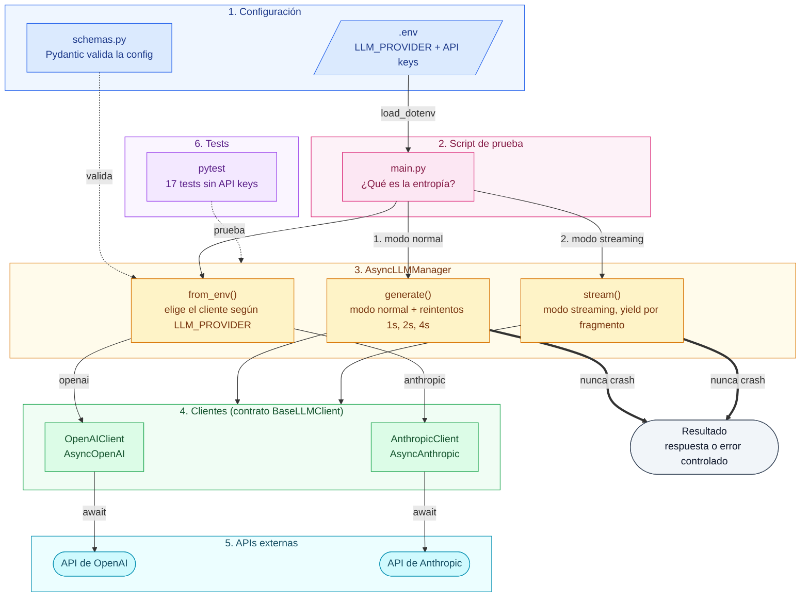

# Unified Async LLM Client

Cliente asíncrono para OpenAI y Anthropic con una interfaz común. Tiene modo normal y streaming, valida los datos con Pydantic y, si algo falla (API key inválida, rate limit, sin conexión), devuelve un error controlado en lugar de cortar el programa.

## Cómo ejecutarlo

Requiere **Python 3.12**.

```bash
# 1. Crear y activar el entorno virtual
py -3.12 -m venv .venv             # Windows
.venv\Scripts\activate
# python3.12 -m venv .venv         # macOS / Linux
# source .venv/bin/activate

# 2. Instalar las dependencias
pip install -r requirements.txt

# 3. Crear el archivo .env a partir del ejemplo y completar las API keys
cp .env.example .env

# 4. Ejecutar el script de prueba
python main.py                     # usa el proveedor de LLM_PROVIDER
python main.py anthropic           # elige el proveedor desde la línea de comandos
```

El script pregunta *"¿Qué es la entropía?"* en **modo normal** (espera la respuesta completa) y en **modo streaming** (imprime cada fragmento a medida que llega).

## Variables de entorno

| Variable | Descripción |
|----------|-------------|
| `LLM_PROVIDER` | `openai` o `anthropic` (por defecto `openai`) |
| `OPENAI_API_KEY` / `OPENAI_MODEL` | Key y modelo de OpenAI |
| `ANTHROPIC_API_KEY` / `ANTHROPIC_MODEL` | Key y modelo de Anthropic |
| `OPENAI_BASE_URL` | Opcional: otro proveedor compatible con OpenAI |
| `LLM_TEMPERATURE` | Opcional, entre 0 y 2 |
| `LLM_MAX_TOKENS` | Opcional, por defecto 512 |
| `LLM_MAX_RETRIES` | Opcional, reintentos ante errores temporales (por defecto 2) |

Solo son obligatorias la key y el modelo del proveedor que se use.

## Estructura

```
schemas.py                  Modelos Pydantic (ChatMessage, ModelConfig, ModelResponse...)
clients/base.py             BaseLLMClient: clase abstracta con el contrato común
clients/openai_client.py    OpenAIClient (usa AsyncOpenAI)
clients/anthropic_client.py AnthropicClient (usa AsyncAnthropic)
manager.py                  AsyncLLMManager: elige el proveedor y maneja errores
main.py                     Script de prueba
tests/                      Tests con pytest
```

## Cómo funciona

Así viaja una pregunta desde `main.py` hasta la API del proveedor y vuelve como respuesta (o como error controlado).



### Qué hace cada parte

| Parte | Qué hace |
|---|---|
| **1. Configuración** (azul) | El `.env` dice qué proveedor usar y guarda las API keys. `schemas.py` valida con Pydantic que la config sea correcta (temperatura 0-2, `max_tokens` > 0). |
| **2. Script de prueba** (rosa) | `main.py` carga el `.env` y hace la pregunta en modo normal y en modo streaming. |
| **3. AsyncLLMManager** (amarillo) | Elige el cliente según `LLM_PROVIDER`. `generate()` reintenta los errores temporales; `stream()` devuelve el texto fragmento por fragmento. |
| **4. Clientes** (verde) | `OpenAIClient` y `AnthropicClient` cumplen el mismo contrato (`BaseLLMClient`) y usan los SDKs asíncronos oficiales. |
| **5. APIs externas** (celeste) | Las llamadas se hacen con `await`, así no se bloquea el programa mientras el modelo responde. |
| **6. Tests** (violeta) | `pytest` prueba el manager y los esquemas con un cliente falso, sin API keys. |

La flecha gruesa marca la regla principal: pase lo que pase, el manager devuelve una respuesta o un error controlado, nunca un crash.

**Cómo funciona:**

1. `BaseLLMClient` define el contrato: `generate()`, `stream()` y `close()`.
2. Cada cliente lo implementa con su SDK y resuelve sus diferencias internamente. Por ejemplo, Anthropic recibe el mensaje `system` aparte y exige `max_tokens`.
3. Cada cliente traduce las excepciones de su SDK a un error común (`LLMClientError`).
4. `AsyncLLMManager` elige el cliente según `LLM_PROVIDER` y nunca lanza excepciones: los errores vuelven dentro de la respuesta.
5. `main.py` no importa ningún SDK, así que cambiar de proveedor no requiere tocar código.

## Manejo de errores

| Error | ¿Se reintenta? |
|-------|----------------|
| Rate limit (429) | Sí |
| Sin conexión / timeout | Sí |
| API key inválida (401) | No: reintentar no lo soluciona |
| Otro error de la API | No |

Los reintentos esperan 1s, 2s, 4s... entre intentos (backoff exponencial). Los SDKs se crean con `max_retries=0` para que no reintenten por su cuenta además del manager.

El **streaming no se reintenta**: si falla a mitad de la respuesta, reintentar repetiría el texto que ya se mostró. El error llega como último fragmento.

### Ejemplo: qué pasa ante un rate limit

Con `LLM_MAX_RETRIES=2`, el manager hace hasta 3 intentos (el primero + 2 reintentos).

**Caso 1: el proveedor se recupera.** Los dos primeros intentos devuelven 429 y el tercero funciona:

```text
[retry] rate_limit error, retrying in 1s...
[retry] rate_limit error, retrying in 2s...
content: La entropía es... | error: None
```

**Caso 2: el rate limit no se resuelve.** Los tres intentos fallan. El programa no se corta: la respuesta vuelve vacía y con el error dentro.

```text
[retry] rate_limit error, retrying in 1s...
[retry] rate_limit error, retrying in 2s...
content: '' | error: type='rate_limit' message='429' retryable=True
```

Desde el código de la app se revisa así:

```python
response = await llm.generate(messages)
if response.error:
    print(f"No se pudo responder: {response.error.type}")
else:
    print(response.content)
```

Estos dos casos están cubiertos por los tests `test_retries_rate_limit_and_then_succeeds` y `test_returns_error_when_retries_run_out`. La secuencia de esperas (1s y después 2s) la verifica `test_backoff_waits_grow_exponentially`.

### Ejemplo: qué pasa si no hay conexión

Salida real de `python main.py` apuntando a un servidor que no responde (`OPENAI_BASE_URL=http://127.0.0.1:1`):

```text
Provider: openai | Model: gpt-5.4-mini
Question: ¿Qué es la entropía?

=== Normal mode ===
[retry] connection error, retrying in 1s...
[retry] connection error, retrying in 2s...
[error] connection: Could not reach the API

=== Streaming mode ===

[error] connection: Could not reach the API
```

En modo normal se reintenta dos veces y después se muestra el error. En streaming no se reintenta. En ningún caso el programa se corta con un traceback.

## Tests

```bash
pip install -r requirements-dev.txt
pytest
```

Los tests no necesitan API keys: usan un cliente falso para probar los reintentos, el streaming y el manejo de errores.

## Probarlo sin API keys con saldo

- Con una key inválida, `python main.py` muestra el error de autenticación controlado, sin que el programa se corte.
- Para ver una respuesta real gratis, se puede usar un proveedor compatible con OpenAI que tenga tier gratuito (por ejemplo Groq): definir `OPENAI_BASE_URL`, su API key en `OPENAI_API_KEY` y uno de sus modelos en `OPENAI_MODEL`.

## Nota sobre `temperature` en Anthropic

La versión 2.x del SDK de Anthropic quitó el parámetro `temperature` de `messages.create()`, porque los modelos actuales no lo usan. Si se configura, el cliente lo envía mediante `extra_body`, que es lo que indica la guía de migración del SDK para modelos anteriores.
